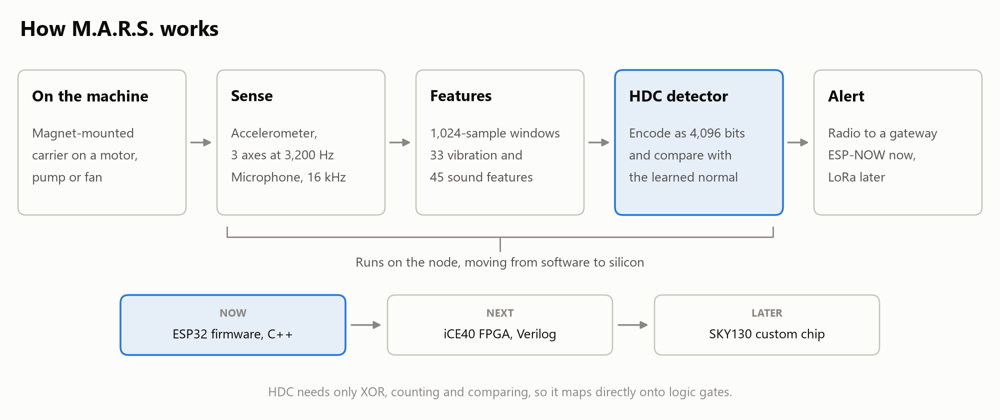
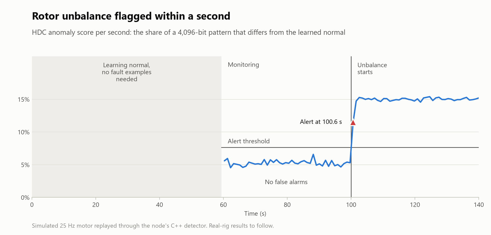
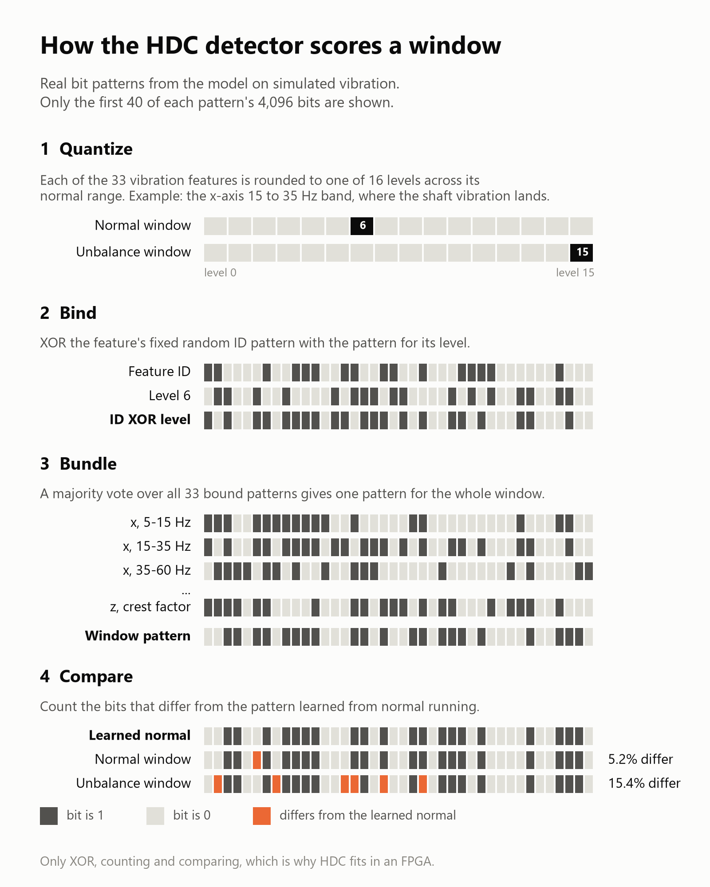
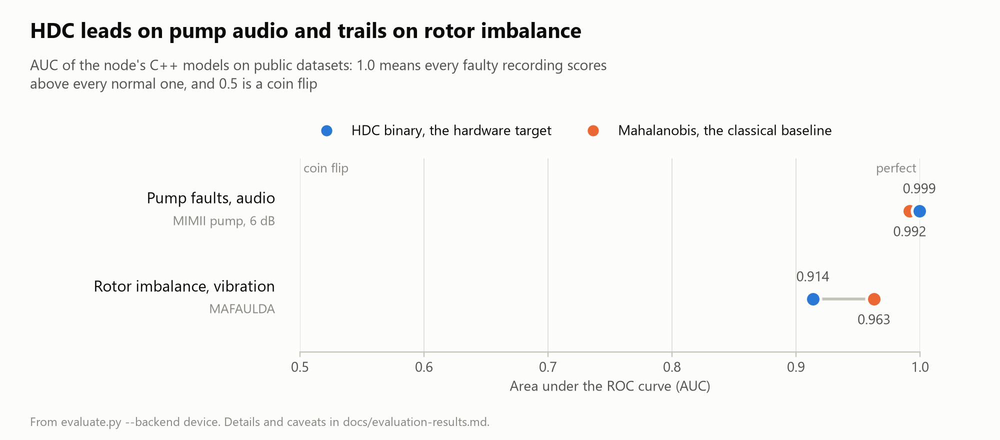

# M.A.R.S. (Machine Anomaly Recognition System)

[](https://github.com/traelynbrasseaux/M.A.R.S.-Machine-Anomaly-Recognition-System-/actions/workflows/tests.yml)

A magnet-mounted sensor node that learns a machine's normal vibration and sound signature and flags anomalies such as rotor unbalance, loose mounting, and pump intake clogs. Built for the Nexus Technology Cup (finals December 14 to 16, 2026).

The node is an ELEGOO ESP-WROOM-32 dev board (original ESP32 with a CP2102 USB-UART chip) carrying an ADXL345 accelerometer (3200 Hz, SPI) and an INMP441 microphone (16 kHz, I2S). Right now it streams raw samples to a laptop over UART so the features and models can be developed on the host. Later phases add radio alerts to a gateway (ESP-NOW for the first prototype, then a LoRa module) and move feature extraction and HDC scoring into Verilog for an iCE40 UP5K and SKY130.

<picture>
  <source media="(prefers-color-scheme: dark)" srcset="docs/img/system-diagram-dark.png">
  
</picture>

<picture>
  <source media="(prefers-color-scheme: dark)" srcset="docs/img/detection-timeline-dark.png">
  
</picture>

The timeline is simulated: a 25 Hz motor whose 1x shaft vibration becomes 4 times stronger at 100 s, replayed through the node's own C++ detector with 40 s of learning and 20 s of calibration. Rebuild every figure on this page with `uv run python scripts/make_figures.py` from `host/`. The same run writes LinkedIn-sized versions, an MP4 of the timeline, and the repo's social preview card to `host/results/social/`.

## Status

- [x] Node firmware streams accelerometer (3,200 Hz) and microphone (16 kHz) frames over UART
- [x] Host tools: capture, simulator, frame loader, and MIMII and MAFAULDA dataset loaders
- [x] Features and models in Python: HDC and a Mahalanobis baseline, evaluated on public datasets
- [x] Features and models ported to C++ for the node, matching the Python (HDC binary bit for bit)
- [x] On-device learning, calibration and detection in the node firmware, with commands, score frames, button and LED
- [ ] Recordings and false alarms per hour on the real rig
- [ ] Radio alerts to a gateway (ESP-NOW, then LoRa)
- [ ] Magnet-mounted carrier
- [ ] Fixed-point golden model for the RTL
- [ ] Feature extraction and HDC in Verilog on an iCE40 UP5K FPGA
- [ ] SKY130 version

## How the HDC detector works

<picture>
  <source media="(prefers-color-scheme: dark)" srcset="docs/img/hdc-explainer-dark.png">
  
</picture>

<picture>
  <source media="(prefers-color-scheme: dark)" srcset="docs/img/results-dark.png">
  
</picture>

HDC needs only XOR, counting and comparing, which is what makes it a hardware target. It edges out the Mahalanobis baseline on pump audio and trails it on rotor imbalance. The MAFAULDA records span shaft speeds from about 12 to 61 Hz, and one averaged HDC prototype likely represents that mix less well than a covariance model does; this is not yet tested. See the [evaluation results](docs/evaluation-results.md) for the full numbers and caveats. The results chart reads `host/results/*_device_metrics.csv`, so run `evaluate.py mimii` and `evaluate.py mafaulda` with `--backend device` before rebuilding it.

## Layout

| Path | What lives there |
|------|------------------|
| `firmware/node/` | PlatformIO project for the node: sampling and UART framing. Pins are in `include/pins.h`. |
| `host/` | Python package `mhm` (uv, Python 3.12): capture tool, simulator, features, models, dataset loaders |
| `host/scripts/` | Dataset download scripts, `evaluate.py`, and `make_figures.py` for the README figures |
| `rtl/` | Verilog for the UPduino v3.1 (iCE40 UP5K) and Tang Nano 20K, tested against `host/mhm/fixed/`; see [rtl/README.md](rtl/README.md) |
| `docs/` | [Node to host interface](docs/interface.md), [capture conventions](docs/capture-conventions.md), and [evaluation results](docs/evaluation-results.md); README figures in `docs/img/` |
| `data/`, `logs/` | Captures, datasets, and logs (gitignored) |

## Setup

```bash
cd host
uv sync
uv run pre-commit install    # ruff check and format on every commit
```

Run the commands below from `host/`. Captures go to `data/captures/` and plots to `host/results/`, both relative to the repo root, wherever you run them from.

## Simulator to evaluation, end to end

`mhm simulate` emits valid frames like a real node: a shaft rotating at 25 Hz with harmonics and noise on the accelerometer, blade-pass tones on the microphone, and `--unbalance` boosting the 1x order. Piping it into `mhm capture` exercises the same parser, log format, and loader the hardware will use.

```bash
for run in 1 2 3 4 5; do
  uv run mhm simulate --fast --duration 60 --seed $run |
    uv run mhm capture --port - --machine sim --condition normal --speed 1500rpm --run $run
done
for run in 1 2; do
  uv run mhm simulate --fast --duration 60 --unbalance --seed $((10 + run)) |
    uv run mhm capture --port - --machine sim --condition unbalance --speed 1500rpm --run $run
done
uv run python scripts/evaluate.py captures --stream accel
uv run python scripts/evaluate.py captures --stream audio
```

- Pipes need bash (Git Bash on Windows), cmd, or PowerShell 7.4+. Windows PowerShell 5.1 re-encodes binary pipes and corrupts the frames.
- Drop `--fast` to stream in real time and watch the live summary. Add `--drop-rate 0.02 --corrupt-rate 0.02` to see dropped frames and CRC errors counted.
- To use a virtual serial port instead of a pipe, create a pair (`socat -d -d pty,raw,echo=0 pty,raw,echo=0` on Linux or macOS, com0com on Windows), then `mhm simulate --port <one end>` and `mhm capture --port <other end>`.

`evaluate.py` holds out whole runs for test and threshold calibration, fits each model on normal windows only, and reports ROC AUC, pAUC (FPR up to 0.1, DCASE 2020 definition), and detection and false alarm rates at a threshold set from the calibration normals.

## Capturing from the node

```bash
uv run mhm capture --port COM5 --machine fan1 --condition normal --speed 1500rpm --run 1 --duration 120
```

The live summary shows frames per second per stream (expect 100 accel and 62.5 audio), CRC errors, and dropped frames. Lines starting with `[node]` are log frames from the firmware, for example a sensor that failed to come up. Naming, vocabulary, and the recording routine are in [capture-conventions.md](docs/capture-conventions.md).

`--port` also takes pyserial URLs such as `socket://host:port` or `rfc2217://host:port`, so capture and `--send` work unchanged through a serial-over-network bridge.

## On-device detection

The node runs the same features and models as `host/mhm`, ported to C++ in `firmware/node/lib/ml`, and learns normal from live data. A test run:

```bash
uv run mhm capture --port COM5 --machine fan1 --condition normal --speed 1500rpm --run 1 \
  --duration 300 --send "learn 60 30"
```

The node learns for 60 s (30 s measuring each feature's range, 30 s building the HDC prototype and Mahalanobis statistics), calibrates its thresholds for 30 s, then detects. `[ml]` lines in the live output show each phase change and any alert, and the capture keeps the node's per-second scores alongside the raw data. The BOOT button starts the same sequence, and the LED blinks while learning and lights on an alert. All commands are in [interface.md](docs/interface.md#commands).

Checking the C++ on the PC, no board needed:

- `uv run pytest` builds `lib/ml` for the PC (`pio run -e native`) and checks it against the Python: features match to float32 rounding, HDC binary scores bit for bit, Mahalanobis within 0.1%. Without `pio` on PATH those tests skip.
- `uv run python scripts/evaluate.py mimii --backend device` runs an evaluation through the C++ instead of the Python.
- `uv run mhm replay data/captures/<file>.bin --learn 60 --calibrate 30` feeds a raw capture through the node's own detector and reports what it would have flagged. Use it to try other learn times or margins on a real recording without recording again.

## Public datasets

```bash
uv run python scripts/download_mimii.py       # pump, 6 dB, id_00: 150 normal + 100 abnormal, about 0.47 GB
uv run python scripts/download_mafaulda.py    # 49 normal + 18 imbalance records, about 0.44 GB
uv run python scripts/evaluate.py mimii
uv run python scripts/evaluate.py mafaulda
```

Both scripts read the archive's index over HTTP range requests and fetch only the chosen files, so the multi-GB zips are never downloaded whole. They print the size first and refuse anything over `--max-gb` (default 1.0).

## Tests and lint

```bash
cd host
uv run pytest
uv run ruff check . && uv run ruff format --check .
```

## Firmware

```bash
cd firmware/node
pio run                  # build for the board
pio run -t upload        # flash over USB
pio run -e native        # build lib/ml for the PC, which the host tests use
```

Windows and macOS may need the Silicon Labs CP210x driver before the board shows up as a serial port. Pins are in `include/pins.h`, and the wiring table is in [interface.md](docs/interface.md#pin-map). At boot the node reports each sensor in a log frame; if one fails its check (for example the ADXL345 ID read), the node says so and keeps streaming the other.
